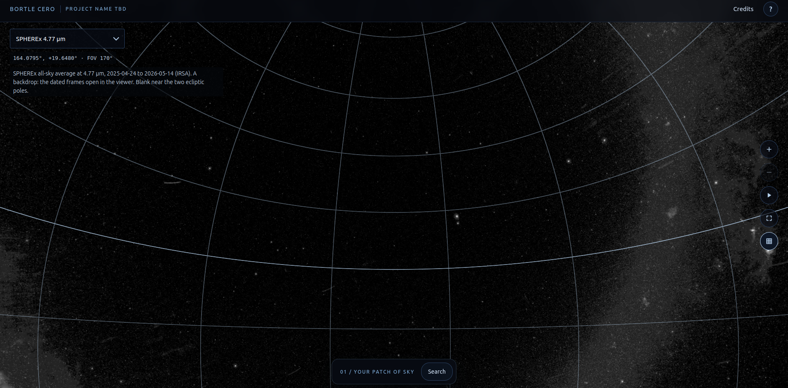

# 🔭 Bortle Cero — Planet X & SPHEREx

> **Spot what moves and changes in the infrared sky.**  
> A public web blink comparator for multi-epoch **NASA SPHEREx** cutouts — built by **Team Bortle Cero** (Guadalajara) for the **NASA Space Apps Challenge 2026**.

🌐 **[Live App — starphere.earth](https://starphere.earth/)** · 👥 **[Team Bortle Cero](https://www.spaceappschallenge.org/2026/find-a-team/bortle-cero/?tab=details)** · 🚀 **[NASA Challenge](https://www.spaceappschallenge.org/2026/challenges/planet-x-and-spherex/)**


---

## ✨ What It Does

- 🌌 **All-Sky Explorer:** Full-screen SPHEREx infrared & visible-light sky map with object search (SIMBAD/Sesame) or custom `RA / Dec`.
- 🔄 **Science-Ready Blink:** Automatically fixes $180^\circ$ spacecraft roll flips (`SPS_EPA`), subtracts zodiacal dust (`ZODI`), groups frames by spectral band (`WCS-WAVE`), and handles saturated cores & cosmic rays (`FLAGS`).
- 🎯 **Gaia DR3 Verification:** Propagates proper motion and parallax to each exposure's `MJD-AVG` for sub-pixel motion checks.
- ⚡ **Live IRSA Pipeline:** Async FastAPI backend fetching real Level 2b FITS cutouts from NASA/IRSA on demand.

---

## 🎯 Official Benchmark Targets

| Target | Category | RA / Dec (deg) | SPHEREx Note |
|---|---|---|---|
| 🌟 **Barnard's Star** | High Proper Motion | `269.452, +4.693` | $10.39''/\text{yr}$ ($\approx 0.84\text{ px}$/pass); saturated core |
| 🟤 **Epsilon Indi B** | Brown Dwarf (T1+T6) | `331.076, -56.794` | Clean unsaturated binary ($4.72''/\text{yr}$), 4 passes |
| ❄️ **WISE 0855−0714** | Coldest Brown Dwarf | `133.760, -7.242` | ~250 K; ~20 px West of 2010 coords; Bands 5 & 6 only |
| 💫 **RW Aurigae** | Variable Star | `76.957, +30.401` | T Tauri variable; compare within same spectral band |
| 🔴 **R Draconis** | Mira Variable | `248.172, +66.754` | North Ecliptic Pole Deep Field (`dr1_deep`, `qr3_deep`) |

---

## ⚡ Quickstart

Requires [Astral `uv`](https://docs.astral.sh/uv/) and Python 3.12+:

```bash
# 1. Setup environment
uv venv --python 3.14 .venv
uv sync --extra dev

# 2. Run tests & linter
uv run pytest
uv run ruff check src/ tests/

# 3. Ingest a target from NASA/IRSA (or use --ra / --dec)
uv run spherex-ingest ingest --target epsilon_indi_b --max-frames 12

# 4. Start the API server (docs at http://localhost:8000/docs)
uv run spherex-ingest serve --host 0.0.0.0 --port 8000
```

---

## 📚 Documentation

- 🖥️ **Frontend & Viewer:** [mockup/README.md](mockup/README.md) · 🎨 [Design System](DESIGN.md)
- ⚙️ **Ingestion & API:** [Async Ingestion API](docs/ASYNC-INGESTION.md) · [Guía de Ingesta (ES)](docs/GUIA-EQUIPO-INGESTA.md)
- ☁️ **Cloud & Ops:** [Cloud Run Staging](docs/CLOUD-RUN.md) · [Deployment Guide](docs/DEPLOYMENT-GUIDE.md) · [Operations Runbook](docs/OPERATIONS-RUNBOOK.md) · [GCP Bootstrap](deploy/gcp/README.md)

---

## 📄 License & Transparency

Released under the **Apache License 2.0**.  
📚 [Sources & Scientific Citations](docs/SOURCES.md) · 🤖 [AI Usage Log](docs/AI-USAGE.md)
