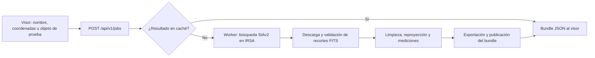

# Cómo llegan los datos de SPHEREx al visor

Bortle Cero busca exposiciones calibradas de nivel 2b en el archivo NASA/IPAC IRSA.
Para cada búsqueda descarga recortes de las exposiciones seleccionadas, los alinea
en una cuadrícula común y entrega al navegador un paquete JSON con las imágenes
listas para animar. Las imágenes de fondo del mapa celeste son independientes de
la serie de exposiciones del visor. [Fuentes de los datos](SOURCES.md).



## 1. De la búsqueda al trabajo

- Si el usuario escribe un nombre como Vega, el navegador obtiene la posición
  mediante Sesame en el espejo de Harvard de SIMBAD. Para una posición personalizada
  envía `ra` y `dec` en grados decimales ICRS. Si reconoce un objeto de prueba,
  envía su identificador como `query` y el servidor carga sus datos astrométricos
  del catálogo del proyecto. Una solicitud de coordenadas por sí sola carece de
  movimiento propio y paralaje. [Buscador](../mockup/sky.js) ·
  [Cliente de datos](../mockup/viewer-data.js) ·
  [Catálogo de objetos de prueba](../src/spherex_ingest/domain/targets.py).
- El visor pide un campo de 180 segundos de arco y hasta 12 exposiciones con
  `POST /api/v1/jobs`. El servidor valida la solicitud y busca un resultado
  vigente para el mismo objetivo y parámetros. Si lo encuentra, devuelve
  `200` con el paquete en `result`. En otro caso devuelve `202` con un trabajo
  nuevo o uno equivalente que ya está en marcha. El visor consulta
  `GET /api/v1/jobs/{job_id}` y, tras `succeeded`, obtiene el paquete en
  `GET /api/v1/jobs/{job_id}/result`. En el sitio público, la descarga y el
  procesamiento se ejecutan en el servidor. [API de trabajos](ASYNC-INGESTION.md).

## 2. Cómo se eligen y descargan los recortes

1. **Localizar exposiciones.** El proveedor calcula el centro de búsqueda en
   MJD 61000 usando la astrometría disponible. Consulta SIAv2 por posición, con
   un círculo de radio 0,01° por colección. La respuesta VOTable contiene los
   metadatos y los enlaces de acceso. Las búsquedas normales usan `spherex_dr1`
   y `spherex_qr3`. R Draconis también consulta las colecciones de campo
   profundo. El proveedor rechaza QR2 porque DR1 reprocesa esas observaciones.
2. **Elegir candidatos.** El proveedor filtra las filas de ciencia y omite
   archivos ya seleccionados en otra colección. Reparte el límite de los
   trabajos públicos entre las colecciones, hasta un total de 12 exposiciones
   por intento con la configuración por defecto. Dentro de cada colección
   procura cubrir distintas bandas de detector y fechas. WISE 0855 prioriza
   las bandas 5 y 6.
3. **Pedir un recorte a IRSA.** Añade los parámetros `center` y `size` a cada
   URL de acceso. Para una salida de 180″ pide un recorte de 261″, con margen
   para que el campo final siga cubierto al corregir la rotación. El servidor
   recibe un FITS con varias extensiones. Cada recorte puede pesar cerca de
   4 MiB, incluida la tabla `EPSF` que entrega el archivo y que el visor
   no utiliza. [Servicio de recortes de IRSA](https://irsa.ipac.caltech.edu/data/SPHEREx/docs/cutout_tool.html).
4. **Validar, almacenar y registrar fallos.** El proveedor verifica la
   integridad de los bloques FITS y analiza el recorte antes de guardarlo
   localmente. También reutiliza tablas de búsqueda vigentes. Con el cambio de
   PR #41, el trabajador puede descargar hasta tres recortes a la vez. Los
   hilos comparten el límite de bytes y el plazo del intento. Las consultas
   SIAv2 siguen siendo secuenciales. Tras agotar los reintentos de una descarga
   o consulta, registra el fallo y puede entregar un resultado parcial si
   quedan imágenes válidas. La API distingue una búsqueda sin observaciones de
   un fallo del archivo. [Proveedor IRSA](../src/spherex_ingest/infrastructure/irsa_sia_provider.py) ·
   [Límites del trabajo](PUBLIC-INGESTION-LIMITS.md).

## 3. Cómo se preprocesa cada exposición

| Paso | Qué hace el servidor |
| --- | --- |
| Leer el FITS | Extrae la imagen calibrada `IMAGE`, las banderas `FLAGS`, la varianza `VARIANCE` y el modelo de luz zodiacal `ZODI`. Lee la geometría celeste, la fecha y la banda del detector. Usa `WCS-WAVE` cuando está disponible para calcular la longitud de onda y el ancho de banda en la posición del objeto. Recurre a valores aproximados del encabezado o de la banda si no puede evaluar esa solución. [Lector FITS](../src/spherex_ingest/infrastructure/mef_parser.py). |
| Limpiar | Resta `ZODI` y estima el fondo residual con una mediana que rechaza valores extremos. Interpola píxeles marcados como defectuosos o afectados por transitorios y protege el halo de las estrellas saturadas. Conserva máscaras de saturación y defectos. Crea una versión con relleno estimado para mostrar los núcleos saturados. [Limpieza](../src/spherex_ingest/processors/cleaners.py). |
| Alinear | Centra una cuadrícula celeste ICRS TAN en la posición calculada a la fecha media de las exposiciones. Corrige la orientación de cada toma usando su WCS y lleva todas las imágenes a la misma escala de 6,15″ por píxel, con norte arriba y este a la izquierda. Un campo solicitado de 180″ produce una cuadrícula de 31 × 31 píxeles. Remuestrea las máscaras por vecino más cercano. [Reproyección](../src/spherex_ingest/processors/reprojector.py). |
| Medir | Predice la posición en la fecha de cada toma usando movimiento propio y paralaje geocéntrico cuando se conocen. Acepta un centroide subpíxel si la señal supera el umbral y la detección está cerca de la posición predicha. La fotometría de apertura estima flujo e incertidumbre y se omite cuando el núcleo está saturado. [Astrometría y fotometría](../src/spherex_ingest/processors/kinematics.py). |
| Sumar | Suma las exposiciones útiles en una sola imagen, la «suma profunda», para encontrar fuentes demasiado débiles para una toma suelta. Desplaza cada exposición para que la posición predicha del objeto en su fecha caiga en el centro, igual que el modo cometa del apilado en astrofotografía. Promedia dando más peso a las tomas menos ruidosas y rechaza los valores discordantes, como un rayo cósmico. Deja fuera los píxeles marcados y las tomas donde el objeto satura. Mide el ruido en la propia suma y cuántas veces sobresale de él el píxel más brillante junto a la predicción; a partir de 5 lo cuenta como detección. Repite la suma sin seguir el movimiento como control. Necesita al menos tres tomas. [Suma profunda](../src/spherex_ingest/processors/stacker.py). |
| Seleccionar y exportar | Descarta tomas con menos del 40 % de píxeles válidos. Usa una escala de brillo común por banda y aplica un estiramiento `asinh` a los PNG. Para cada banda con un par separado por al menos un día, selecciona el par más cercano en longitud de onda y resta la imagen temprana de la tardía. Incluye la diferencia de longitud de onda para interpretar el resultado. [Exportación del paquete](../src/spherex_ingest/exporters/bundle_exporter.py). |

## 4. Qué recibe y muestra el navegador

El trabajador publica el `BlinkBundleDTO` en el almacén de resultados antes
de marcar el trabajo como completado. El visor usa `frames_chronological` o
`frames_by_band` para reproducir la secuencia y muestra `png_base64` como
una imagen. El paquete también lleva las coordenadas de los marcadores,
`matrix_mjy_sr`, las máscaras, los enlaces a los FITS de origen,
`difference_maps`, `dropped_frames`, avisos y citas. Las matrices exportadas
usan la orientación de pantalla y pueden incluir valores estimados en los
núcleos saturados. [Esquemas de datos](../src/spherex_ingest/domain/models.py).

Desde la versión 1.1.0 del esquema el paquete lleva también `deep_stack`: la
suma profunda como imagen y matriz, cuántas exposiciones entraron, su rango de
longitudes de onda y fechas, la reducción de ruido y la detección medida. Si
no se pudo construir, `deep_stack` es nulo y `deep_stack_skipped_reason` dice
por qué: `too_few_frames` o `target_saturated`. La suma mezcla longitudes de
onda, así que indica si hay una fuente y dónde está, no cuánto brilla; por eso
no lleva flujo. Las estrellas de campo pueden verse corridas cuando el objeto
se mueve, porque la imagen sigue al objeto.

El filtro varía dentro del detector. Dos tomas de la misma banda pueden tener
distintas longitudes de onda, de modo que un cambio de brillo en el parpadeo
también puede tener un origen espectral. Las capas de diferencia pueden incluir
la reparación visual de píxeles saturados. Para interpretar un cambio, revisa
las longitudes de onda, las máscaras y los avisos del paquete.

El despliegue de demostración usa SQLite y almacenamiento temporal de Cloud Run
para la cola y la caché local. Una búsqueda puede volver a consultar IRSA si se
atiende desde otra instancia o si la caché caduca. La configuración admite
Cloud Storage privado para reutilizar paquetes procesados entre instancias.
[Almacenamiento de resultados](RESULT-STORAGE.md) ·
[Medición de latencia](OPERATIONS-RUNBOOK.md#measuring-live-search-latency).

## 5. Cómo reproducirlo en desarrollo

Arranca la API y abre `http://localhost:8000/docs` para probar
`POST /api/v1/jobs` con el flujo que usa el visor.

```bash
uv run spherex-ingest serve --host 127.0.0.1 --port 8000
```

Ejemplo de cuerpo de una búsqueda de Vega por coordenadas.

```json
{
  "ra": 279.23473479,
  "dec": 38.78368896,
  "size_arcsec": 180,
  "max_frames": 12
}
```

La CLI permite guardar el JSON y los PNG fuera del visor. Aquí
`--max-frames` es un límite **por colección**.

```bash
uv run spherex-ingest ingest --target epsilon_indi_b --max-frames 6 --output-dir output
```

Busca `bundle.json`, `frames/` y `differences/` en
`output/epsilon_indi_b/`. El visor desplegado obtiene sus paquetes de la API.
